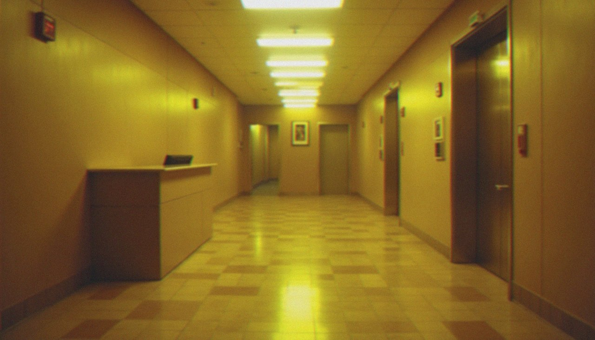
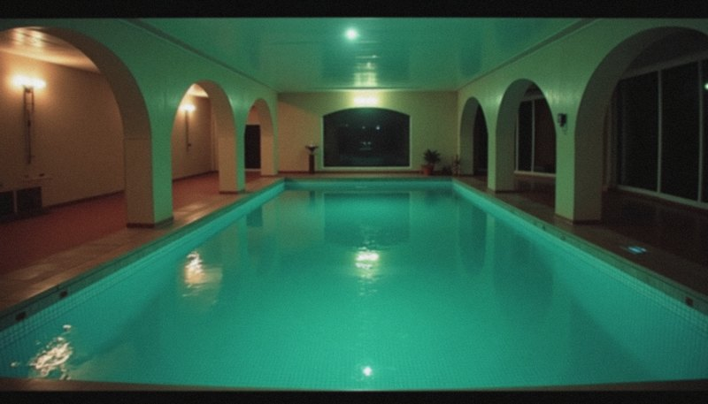
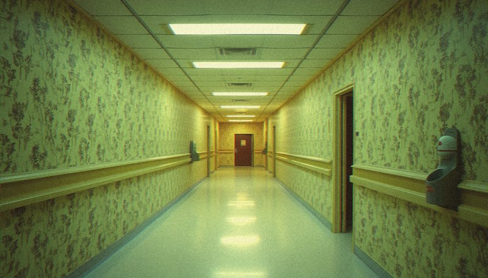
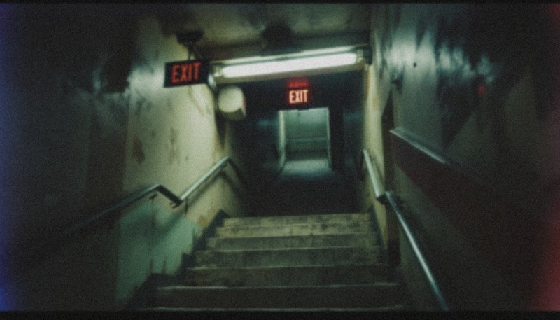
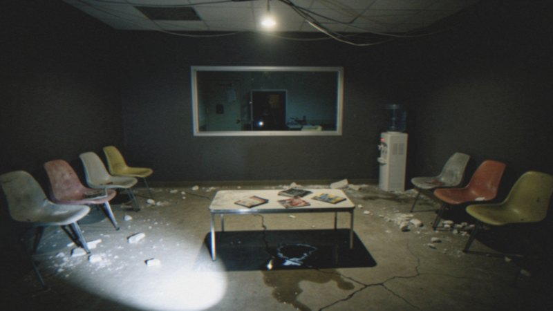
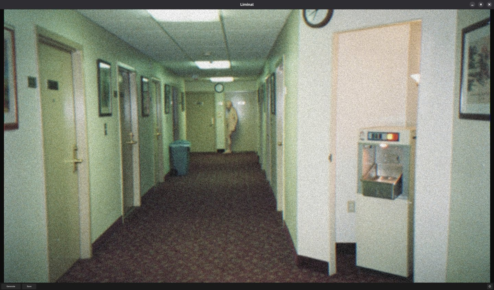

<div align="center">


# Liminal Generator

**A small Linux app that generates unique liminal spaces and Backrooms photos with a single click.**

Each click builds a new prompt (place, lighting, camera, details…), sends it to the image model you choose, then gives the result the look of a cheap analog photo from 1985 to 2008.




**English** · [Français](README.fr.md)

</div>

---

## Features

- 🚪 **One button**: click *Generate*, get a new 16:9 image of an empty, uncanny place.
- 🎲 **Never the same image twice**: the prompt is assembled from nearly 200 fragments (places, walls, floors, lighting, cameras, details, anomalies). Every combination is remembered and never drawn again, and the same place or lighting never comes back too soon.
- 📼 **Analog look**: every image goes through a local post-process with random strength (low resolution, blur, chromatic aberration, faded colours, film grain that is sometimes missing or in colour), so it looks like a VHS frame or a disposable camera shot, not like CGI.
- 👤 **Something is there, sometimes**: about one image in six shows an ambiguous human presence (a far-away silhouette, a shadow with no one to cast it, someone facing the wall…). Never two in a row.
- 🔌 **Your choice of model**: Replicate, fal.ai, OpenAI or Google, with your own API key. The price per image is shown next to each model, and you can also enter any other model id.
- 💾 **Save as**: native save dialog, PNG, with a `.json` next to it that holds the prompt, provider, model and seed.
- 🖤 **Minimal**: an image, *Generate*, *Save* and ⚙. Dark theme, and the window never freezes while an image is being generated.

<table>
<tr>
<td align="center"></td>
<td align="center"></td>
</tr>
<tr>
<td align="center"></td>
<td align="center"><br><sub>One of the rare presences</sub></td>
</tr>
<tr>
<td align="center"></td>
<td align="center"></td>
</tr>
</table>

<div align="center">

<br><sub>The app</sub>
</div>

## Requirements

- **Linux** with an X11 session, or Wayland with XWayland (the default on GNOME and KDE).
- **Python 3.12+** and **tkinter**, which pip cannot install:
  - Fedora: `sudo dnf install python3-tkinter`
  - Debian/Ubuntu: `sudo apt install python3-tk python3-venv`
- **An API key** from one of the providers below, with a little credit on it.
- Optional: **zenity**, for the native GNOME save dialog.

## Install

```bash
git clone https://github.com/boomer24vs/liminal-generation.git
cd liminal-generation
./install.sh
```

The script:
1. checks Python and tkinter;
2. creates a Python environment in `.venv/` and installs the dependencies;
3. adds **Liminal Generator** to your application menu.

## Usage

Launch **Liminal Generator** from your application menu, or run `.venv/bin/python main.py`.

The first time, click **⚙**, pick a provider, paste your API key and choose a model. *Verify* checks the key without generating anything, so it costs nothing.

| Action | Effect |
|---|---|
| *Generate*, `Space` or `Enter` | Generates a new image |
| *Save* or `Ctrl+S` | Saves the image as PNG, plus a `.json` with its prompt and settings |
| ⚙ | Provider, API key and model |
| `Esc` | Quits |

## Providers and models

| Provider | Built-in models | Indicative price per image |
|---|---|---|
| [Replicate](https://replicate.com) | FLUX.1 schnell (default) · FLUX.1 dev · FLUX 1.1 pro | $0.003 · $0.025 · $0.04 |
| [fal.ai](https://fal.ai) | FLUX.1 schnell · FLUX.1 dev · FLUX 2 pro | ~$0.003 · ~$0.025 · ~$0.05 |
| [OpenAI](https://platform.openai.com) | GPT Image 2.5 Flare · GPT Image 2 | ~$0.05 · ~$0.04 |
| [Google](https://aistudio.google.com) | Gemini 3.1 Flash Lite Image · Gemini 2.5 Flash Image · Gemini 3.1 Flash Image | $0.034 · $0.039 · ~$0.067 |

Prices are indicative: check them on the provider's site. For this style, the *pro* FLUX models give the most convincing results. Choose *custom…* in the model list to use any other model the provider hosts.

**API keys** are read from these environment variables first: `REPLICATE_API_TOKEN`, `FAL_KEY`, `OPENAI_API_KEY`, `GEMINI_API_KEY`. Keys typed in ⚙ are stored in `~/.config/liminal/config.json`, readable by you only. They are never written inside the project folder.

## Customising the prompts

The prompts are plain text in [`prompts/`](prompts): one file per category, one fragment per line, `#` for comments. Add, remove or rewrite lines to steer the images. A `{slot}` in a fragment is replaced by a random line from `prompts/slots/<slot>.txt`.

## Troubleshooting

| Problem | Fix |
|---|---|
| `No module named 'tkinter'` | `sudo dnf install python3-tkinter` (Fedora) or `sudo apt install python3-tk` (Debian/Ubuntu) |
| `Add an API token in ⚙` | No key for the selected provider: paste one in ⚙ |
| `invalid token` | The key is wrong or incomplete. For fal.ai, paste the whole key, including the part after `:` |
| `quota or rate limit reached` | No credit left on your provider account, or too many requests: add credit or wait a moment |
| `unknown model` | The custom model id does not exist for this provider |
| Window does not open on pure Wayland | XWayland is required (it is on by default on GNOME and KDE) |

Tested on Fedora 43 with GNOME 49 (Wayland + XWayland). Other desktops should work but have not been tested yet: issues are welcome.

## Development

```bash
.venv/bin/pip install -r requirements-dev.txt
.venv/bin/python -m pytest tests/
```

The tests never call a real API: every network call is mocked.

## Uninstall

```bash
rm ~/.local/share/applications/liminal-generator.desktop
rm -rf ~/.config/liminal ~/.local/share/liminal
rm -rf /path/to/liminal-generation
```

## Project layout

| File | Role |
|---|---|
| `main.py` | Window, buttons, settings panel, background threads |
| `generator.py` | Prompt assembly and uniqueness (history, no close repeats, seed) |
| `providers.py` | One HTTP call per provider, and the built-in model list |
| `postprocess.py` | Local analog look (Pillow) |
| `storage.py` | Config, image download and saving, `.json` metadata |
| `prompts/` | Prompt fragments, one text file per category |
| `install.sh` | One-step install |

## Legal

- **Not affiliated with the Backrooms, Kane Pixels or any image provider.** The Backrooms and r/LiminalSpace are only the inspiration.
- Images are generated on **your own** provider account and billed to it. What you may do with them depends on the provider's terms.
- The code is under the [MIT license](LICENSE).
